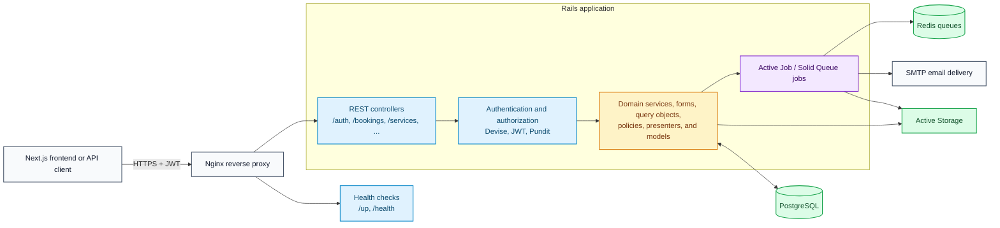
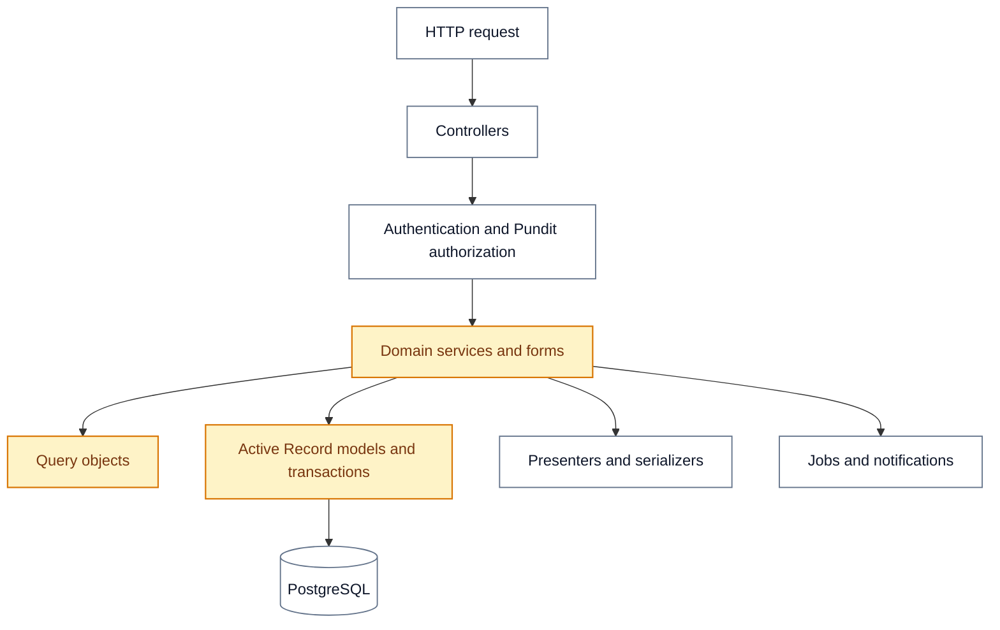

# Backend Architecture

The Ayoj backend is a Ruby on Rails API application. It exposes REST endpoints, owns the application’s business rules and persistence, and uses background processing for work that should not block HTTP requests.

## System Overview



## HTTP Interfaces

| Interface | Current entry point | Use |
|---|---|---|
| REST | Resource routes at the Rails root, such as `/auth`, `/services`, `/vendors`, `/bookings`, and `/portfolio_items` | Primary browser-facing CRUD and workflow operations, including uploads |
| Health | `/up`, `/health` | Deployment and service health checks |
| Development tools | `/solid_queue`, `/admin` | Available for operations and administration |

There is no Rails `/api/v1` namespace. When deployed behind the shared Nginx configuration, the public `/api/*` prefix is a proxy concern and is stripped before the request reaches Rails.

## Application Layers



| Layer | Key locations | Responsibility |
|---|---|---|
| Interface | `app/controllers/` | Request validation, response shaping, and REST entry points |
| Access control | `app/controllers/concerns/`, `app/policies/`, JWT services | Authentication and authorization |
| Domain logic & workflows | `app/domain/<bounded_context>/`, `app/forms/` | Canonical home for domain commands, queries, state machines, and business rules |
| Read and presentation | `app/models/queries/`, `app/presenters/` | Reusable read models and response formatting |
| Persistence | `app/models/`, `db/` | Active Record associations, validations, and database schema |
| Async and integrations | `app/jobs/`, `app/mailers/`, Active Storage | Image processing, notifications, mail delivery, and media attachment handling |

The codebase is organized as a modular Rails application through these directories. `app/domain/<bounded_context>/` is the single canonical home for all domain logic.

## Background Work and Storage

- Rails uses Solid Queue as its Active Job adapter and Solid Cache for key-value caching (both PostgreSQL-backed; no Redis dependency).
- Background jobs include image processing, notification delivery, booking reminders, and vendor-stat recalculation.
- PostgreSQL is the primary transactional data store and backing engine for queues and cache.
- Active Storage owns attached service, portfolio, review, and avatar media. Upload keys are partitioned by `<environment>/<domain>/<year>/<month>/<token>.<ext>` using `ActiveStorageKeyGenerator` to maintain clear isolation, lifecycle governance, and CDN caching boundaries in cloud storage (Cloudflare R2 / S3).
- Mailers deliver transactional and notification email through the configured SMTP/Resend provider.

## Local Development

```bash
cd backend
bundle install
rails db:prepare
rails s -p 3001
```

Run PostgreSQL and Redis with the root `docker-compose.local.yml` configuration when developing the applications on the host.
