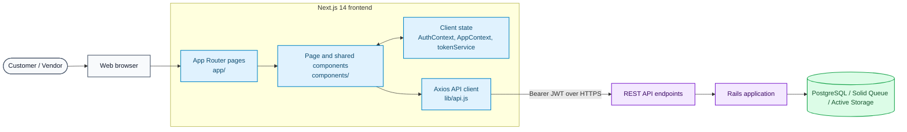
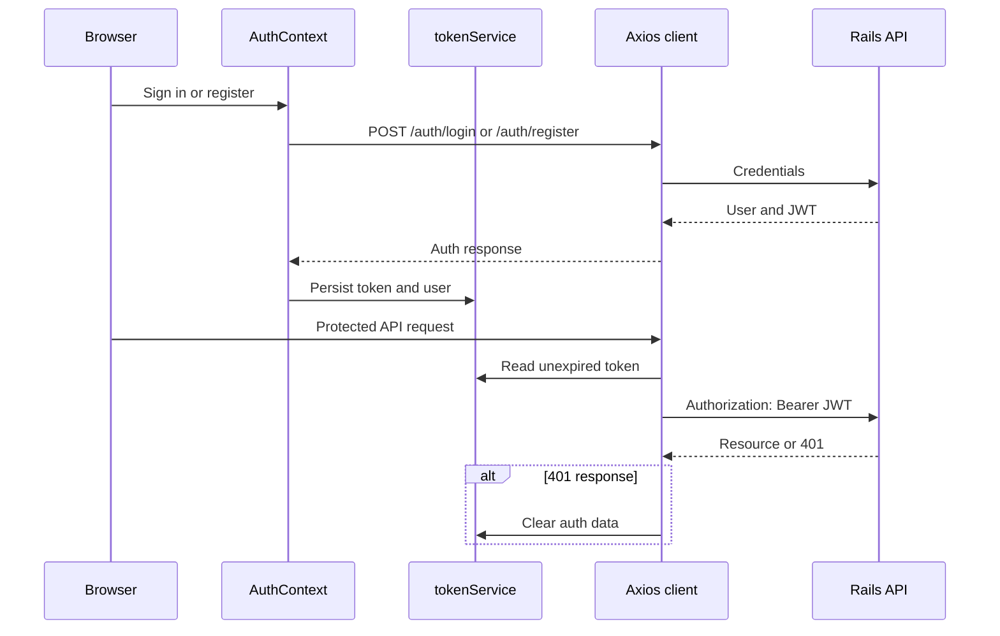

# Frontend Architecture

The frontend is a Next.js 14 application using the App Router, React 18, TypeScript, and Tailwind CSS. It is the browser-facing application for customers and vendors; business rules and persistence remain in the Rails backend.

## System Context



## Frontend Layers

| Layer | Location | Responsibility |
|---|---|---|
| Route entry points | `app/` | App Router pages, root layout, error and not-found boundaries |
| Feature and shared UI | `components/` | Booking, marketplace, vendor, navigation, auth, and reusable UI components |
| Client state | `lib/contexts/`, `lib/tokenService.js` | Authenticated user state, shared UI state, and browser token persistence |
| API boundary | `lib/api.js` | Axios client, base URL, JWT authorization header, and unauthorized-response handling |
| Static/mock data | `lib/data/`, `lib/mockVendorData.ts` | Development and presentation data; not the production source of truth |

### Routing and rendering

Routes live under `app/`; there is no React Router or `src/` application directory. The root layout installs the `AuthProvider` and `AppProvider`. Interactive components opt into client rendering where needed, while Next.js retains its normal App Router rendering model for route entry points.

The principal route areas are:

- Public discovery: `/`, `/marketplace`, `/services`, `/vendors`, and `/vendors/[id]`.
- Authentication: `/login` and `/register`.
- Customer flows: `/customer`, `/customer/dashboard`, `/customer/bookings`, and `/customer/favorites`.
- Vendor flows: `/vendor`, `/vendor/dashboard`, `/vendor/bookings`, and `/vendor/portfolio`.
- Booking flows: `/booking` and `/booking/[serviceId]`.

## Authentication and API Flow



`NEXT_PUBLIC_API_URL` identifies the backend origin. It defaults to `http://localhost:3001` for local development. In a same-origin proxy deployment it can be `/api`; the proxy removes that prefix before forwarding to Rails.

## Deployment Boundary

The intended production Compose design places Nginx before the Next.js frontend and Rails backend. Nginx serves the frontend at `/`, forwards `/api/*` to Rails after removing `/api`, and forwards Rails health and Active Storage paths. The frontend should make no direct connection to PostgreSQL, Redis, Sidekiq, or Active Storage.

> Deployment review: `docker-compose.yml` names the Rails service `backend`, while `docker/nginx/prod.conf` currently points its `backend` upstream at `web:3000`. Align that upstream name before relying on the proxy topology shown above.

## Development

```bash
cd frontend
npm install
npm run dev
```

Set `NEXT_PUBLIC_API_URL=http://localhost:3001` when running the frontend directly alongside the Rails server.
